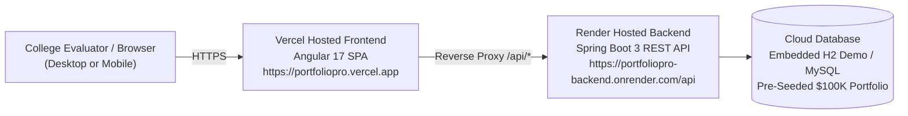

# 🚀 PortfolioPro — Cloud Deployment & College Submission Guide

A complete, step-by-step institutional guide to deploy **PortfolioPro** (Spring Boot 3 + Angular 17) to **Render** and **Vercel** with a free public live URL for college evaluators.

---

## 🏛️ Deployment Architecture



---

## 🔑 Evaluator & College Submission Credentials

The platform comes pre-configured with an institutional demo account:
- **Live URL**: `https://YOUR-APP.vercel.app`
- **Username**: `trader_demo`
- **Password**: `Trader123!`
- **Starting Cash**: `$100,000.00 USD`
- **Pre-Loaded Holdings**: AAPL (25 shares), NVDA (15 shares), MSFT (10 shares)
- **Interactive Swagger API Docs**: `https://YOUR-BACKEND.onrender.com/api/swagger-ui.html`
- **1-Click Login**: Evaluators can also click the **"Autofill Demo"** button on the login screen for instant access!

---

## ☁️ PART 1: Deploy Backend to Render (100% Free)

Render hosts Dockerized Spring Boot applications for free without credit cards.

### Step 1: Sign in to Render
1. Go to [https://render.com](https://render.com) and click **"Get Started"** or **"Sign In"**.
2. Sign in with your **GitHub Account** (`SurajYadav5`).

### Step 2: Create New Web Service
1. On your Render Dashboard, click the blue button: **"New +"** ➔ **"Web Service"**.
2. Select **"Build and deploy from a Git repository"** ➔ click **Next**.
3. Select your repository: **`SurajYadav5/HCL`** (or paste your repo URL).

### Step 3: Configure Settings
Fill in the following fields:
- **Name**: `portfoliopro-backend`
- **Region**: `Oregon (US West)` or `Singapore`
- **Branch**: `main`
- **Root Directory**: `portfoliopro-backend`
- **Environment**: **`Docker`** *(Render will automatically detect the Dockerfile!)*
- **Instance Type**: **`Free`**

### Step 4: Environment Variables (Optional)
Under the **"Environment Variables"** section, click **"Add Environment Variable"**:
- Key: `SPRING_PROFILES_ACTIVE` | Value: `cloud`
- Key: `PORT` | Value: `8080`

### Step 5: Click "Create Web Service"
- Render will start building the Docker image using Maven, download dependencies, and boot the Spring Boot server.
- Once finished, Render will display: `Your service is live 🎉`
- Copy your live backend URL (e.g. `https://portfoliopro-backend-xxxx.onrender.com`).
- Verify it by opening: `https://portfoliopro-backend-xxxx.onrender.com/api/actuator/health` ➔ should return `{"status":"UP"}`.

---

## 🌐 PART 2: Deploy Frontend to Vercel (100% Free)

Vercel provides blazing-fast global CDN hosting for Angular applications.

### Step 1: Sign in to Vercel
1. Go to [https://vercel.com](https://vercel.com) and sign in with your **GitHub Account** (`SurajYadav5`).

### Step 2: Import Repository
1. On your Vercel Dashboard, click **"Add New..."** ➔ **"Project"**.
2. Find and click **"Import"** next to **`SurajYadav5/HCL`**.

### Step 3: Project Configuration
- **Project Name**: `portfoliopro`
- **Framework Preset**: **`Angular`**
- **Root Directory**: Click "Edit" and choose **`portfoliopro-frontend`** ➔ click Continue.
- **Build and Output Settings**:
  - Build Command: `npm run build`
  - Output Directory: `dist/portfoliopro-frontend/browser`

### Step 4: Click "Deploy"
- Vercel will install dependencies and compile the production bundle.
- In ~45 seconds, your app will be live with a URL like `https://portfoliopro-xxxx.vercel.app`!

---

## 🔄 PART 3: Connect Frontend to Backend (Final Step)

In `portfoliopro-frontend/vercel.json`, update the proxy destination with your actual Render URL:

```json
{
  "version": 2,
  "buildCommand": "npm run build",
  "outputDirectory": "dist/portfoliopro-frontend/browser",
  "rewrites": [
    {
      "source": "/api/:match*",
      "destination": "https://YOUR-RENDER-BACKEND-URL.onrender.com/api/:match*"
    },
    {
      "source": "/(.*)",
      "destination": "/index.html"
    }
  ]
}
```

Commit and push to GitHub:
```bash
git add portfoliopro-frontend/vercel.json
git commit -m "Update Render backend URL for production proxy"
git push origin main
```
Vercel will automatically redeploy with the live backend connected!

---

## 💻 PART 4: Offline Demo Mode (For College Lab Submission)

If the college examination lab does not have high-speed internet, you can run the entire platform locally with zero setup:

1. **Backend Executable JAR**:
   Located at: `portfoliopro-backend/target/portfoliopro-backend-1.0.0.jar`
   Run command:
   ```cmd
   java -jar portfoliopro-backend/target/portfoliopro-backend-1.0.0.jar
   ```
2. **1-Click Full-Stack Launcher**:
   Simply double-click:
   `start-all.bat`
   It automatically launches MySQL, the Spring Boot Backend on Port 8085, and the Angular Frontend on Port 4200, then opens the browser directly!
